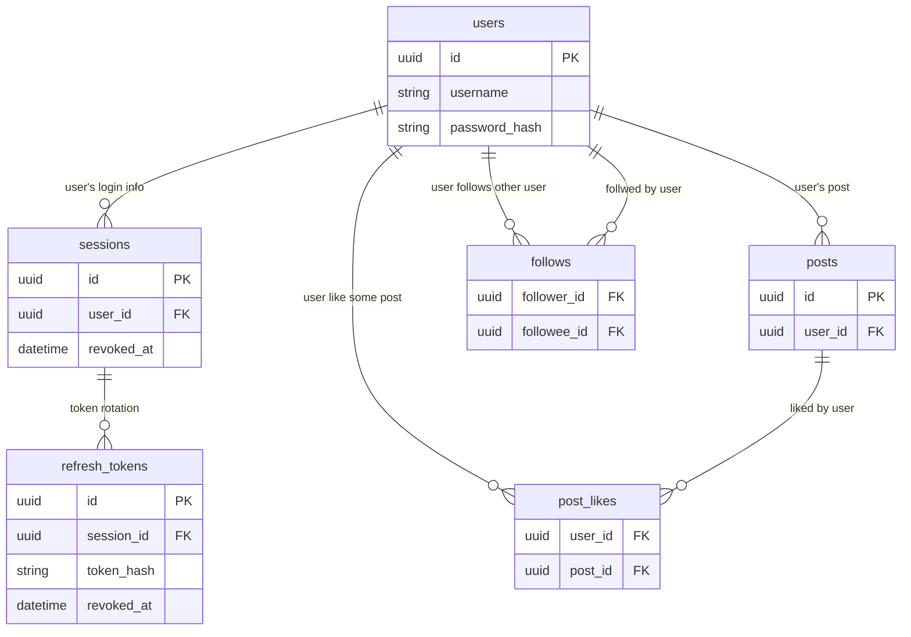

- `session` と `refresh_token` を分離することで、セッションの生存中にリフレッシュトークンは複数回ローテーションさせていることを表現する
- `refresh_tokens` の `consumed_at` と `revoked_at` を区別している。
    - `consumed_at` : 正常にローテーションされた
    - `revoked_at` : 管理操作などで強制無効になった
- 部分 UNIQUEインデックスを作成することで、有効な `refresh_token` をセッションごとに1つにする

# JWT claims に入れる内容

```json
{
  "sub": "0199b5e8-1c42-7a20-8b3d-7d96e120a932",
  "sid": "0199b5ea-42e1-7810-a237-0e4a29d18921",
  "iss": "my-app",
  "aud": "my-app-api",
  "iat": 1791600000,
  "exp": 1791600900
}
```

- sub : ユーザーの ID
- sid : セッションの ID
    - sid を含めておくことで、セッション単位で失効させる仕様に対応できるようにする
    - 